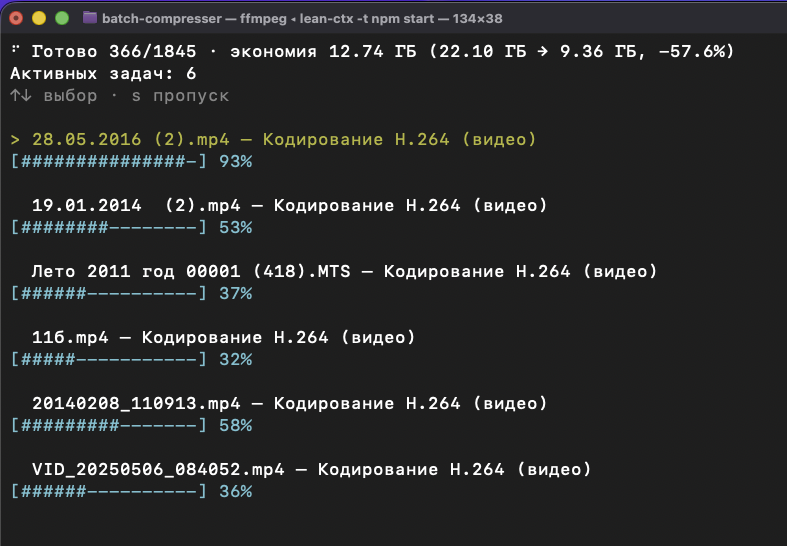

# Batch Compressor

Сжимает фото и видео в выбранной папке — прямо в терминале, по шагам.



## Что умеет

- Обходит папку целиком (включая подпапки)
- Сжимает фото и/или видео — что выберете
- Не увеличивает файлы: если результат не меньше исходника, оставляет как было
- Можно заменить оригинал или сохранить рядом (`*_compressed`)
- Можно продолжить с того места, где остановились (по прошлому логу)
- Язык интерфейса — как в системе (русский или английский)

## Как запустить

Нужен [Node.js](https://nodejs.org/) (16 или новее).

```bash
npm install
npm start
```

Или сразу с папкой:

```bash
npm start -- --path ~/Pictures
```

Дальше мастер спросит настройки и покажет, сколько файлов найдено — можно подтвердить или вернуться назад.

## Видео и ffmpeg

Для видео нужен [ffmpeg](https://ffmpeg.org/). Если его нет, программа предложит установить или продолжить только с фото.

Кратко установить самому:

```bash
# macOS
brew install ffmpeg

# Windows
winget install --id Gyan.FFmpeg -e
```

## Во время работы

- `[` / `]` — меньше или больше параллельных видео
- ↑↓ и `s` — пропустить текущее видео (файл не трогаем)
- `o` — открыть папку с файлом

В конце — сводка и лог в той же папке.

## MCP (для ИИ-агентов)

Тот же движок можно вызывать из Cursor и других клиентов через Model Context Protocol:

```bash
npm run build
npm run mcp
```

В конфиге MCP (stdio): команда `node` и аргумент путь к `dist/mcp/cli.js` в этом репозитории (или `batch-compressor-mcp` после `npm link`).

Опционально: `BATCH_COMPRESSER_PATH` — начальная папка. Подробности для агентов — в `llms.txt` и `AGENTS.md`.
